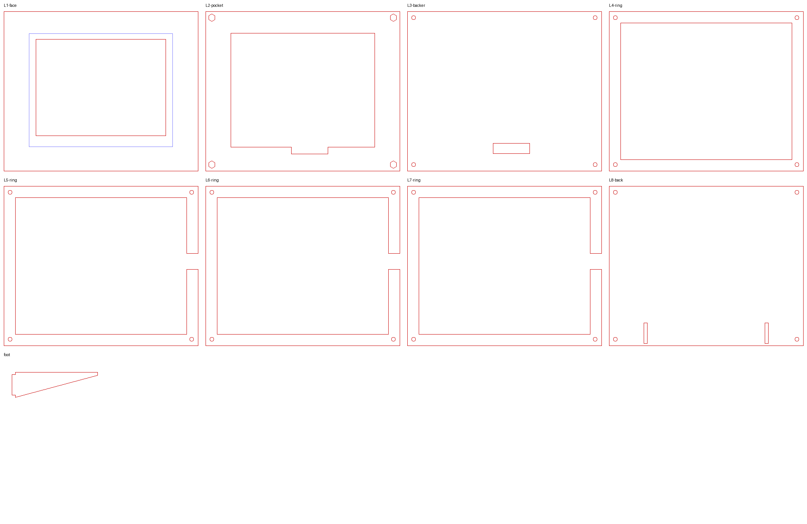

# Enclosure: laser-cut desk frame

Decided: **landscape, desk, battery.** First draft. Cut it from cardboard or scrap before wasting nice wood.

`enclosure/frame.py` is parametric. Edit the numbers at the top (sheet thickness, kerf, border sizes, lean angle) and run it to regenerate `enclosure/svg/*.svg`. The SVGs are in mm with red hairline cuts and import directly into WeCreat MakeIt or LightBurn.

## The design

A 170 × 140 × 24 mm stack of eight 3 mm layers that leans back 15° on two slot-in feet.

| Layer | Job |
|---|---|
| L1 face | Window 113.9 × 84.8 mm, 0.5 mm inside the active area so the glass's dead border never shows. 24 mm border on top, ~30 mm at the bottom: the classic weighted mat. |
| L2 pocket | Holds the panel (125.4 × 99.5 + 0.3 mm clearance). Tongue at the bottom for the ribbon to fold back. **Hex pockets capture four M3 nuts.** |
| L3 backer | Flat support across the whole back of the glass. Slot for the ribbon. |
| L4–L7 rings | 150 × 120 × 12 mm cavity for the ESP32, battery and charger. L5–L7 have a 14 × 9 mm notch in the right wall for the charger's USB-C. |
| L8 back | Four M3 holes, two press-fit slots for the feet. |
| Feet ×2 | Profile computed so the long edge sits flat on the desk at 15°. They reach ~72 mm behind the frame. |

Panel position comes from Waveshare's mechanical drawing: the active area is centered left to right, 4.6 mm from the top edge, and 9.1 mm from the ribbon edge.

## Assembly

1. Glue **L1 + L2** (front). Clamp flat; wood glue squeeze-out in the window is hard to clean, so go light near the opening.
2. Glue **L4–L7** (ring block), lining them up with M3 screws through the corner holes.
3. Drop the four M3 nuts into L2's hex pockets.
4. Face-down: panel into the pocket, **2 mm craft foam** cut to the panel size behind it (it's 0.9 mm glass in a 3 mm pocket; the foam takes up the slack and cushions it), then L3, then the ring block. Fold the ribbon back through the slots.
5. Mount electronics in the cavity (double-sided foam tape): charger against the right wall so its USB-C sits in the notch, battery and ESP32 beside it.
6. L8 on, four **M3 × 20** screws from the back into the nuts. Everything except L1+L2 comes apart for service.
7. Press the feet into the back.

## Materials

- **Face:** something nice, e.g. 3 mm walnut or maple ply. Or paint MDF matte black, which makes the white of the panel pop.
- **Everything else:** 3 mm Baltic birch. Eight 170 × 140 layers ≈ four 12 × 12" sheets plus scrap for the feet.
- 4× M3 × 20 socket or button head, 4× M3 hex nuts, 2 mm EVA foam sheet.

## Check before cutting

- **Measure your sheet.** "3 mm" ply is often 2.7–3.2 mm. Set `T` and re-run, since the feet slots and stack depth depend on it.
- **Kerf:** `KERF = 0.12` is a guess for the 40 W diode. Cut the back panel's foot slot and a foot from scrap first and adjust until it's a snug press fit.
- **USB-C notch height:** depends on how tall your charger board sits. Move it with `USB_NOTCH` / `USB_LAYERS`.
- **Which way is up:** the frame assumes the ribbon exits the bottom. If the image renders upside down, set `rotate: 180` in `quotes.yaml`; no recut needed.
