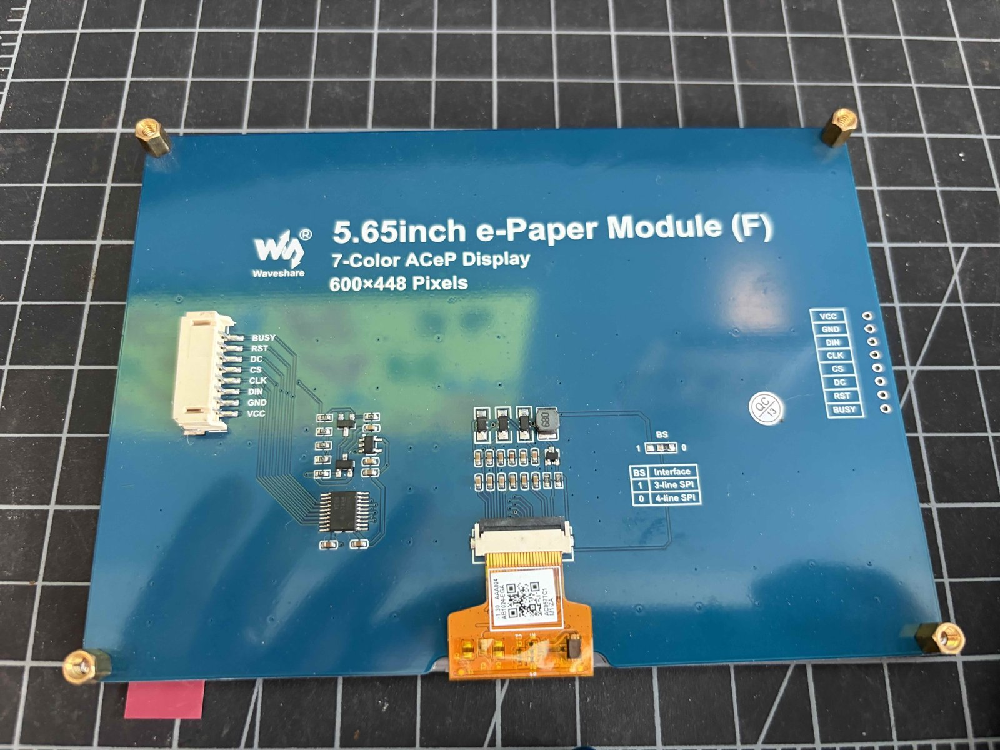
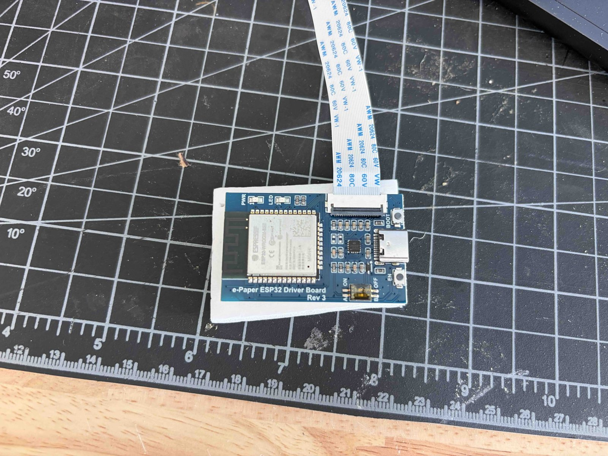

# Hardware

## What's on the bench

| Part | Identified as | Notes |
|---|---|---|
| Display | **Waveshare 5.65inch e-Paper Module (F)**, 7-color ACeP, 600×448 | Panel FPC label reads **AC057TC1**. It's the *Module* (blue adapter PCB with an 8-pin header and a BS jumper for 3-/4-line SPI), not the Pi HAT. |
| Controller | **Waveshare e-Paper ESP32 Driver Board, Rev 3** | ESP32-WROOM-32E (Wi-Fi + BT), USB-C, CH343 serial chip, BOOT/EN buttons, A/B "Display Config" switch, 24-pin FPC connector for raw panels. |

The ESP32 board is the right brain for this. It has Wi-Fi, it deep-sleeps at microamps, and it's made to drive raw Waveshare panels directly. No Pi or Arduino needed.

Same glass as the Pimoroni Inky Impression 5.7", which is useful when searching for other people's notes.

## Panel facts that shape the design

- **Active area:** 114.9 × 85.8 mm. Raw panel: 125.4 × 99.5 × 0.91 mm. Module PCB: 138.5 × 100.5 mm.
- **Seven pigments:** black, white, green, blue, red, yellow, orange. No grays, so text is rendered hard-edged rather than anti-aliased.
- **Refresh:** ~30 s, full-screen, flashes through colors. No partial refresh. Fine for once a day.
- **Waveshare's rules:** wait ≥180 s between refreshes, refresh at least once every 24 h, and **always put the panel to sleep after a refresh**. Leaving it powered holds it at high voltage and permanently damages it. The firmware always calls `epd::sleep()`.
- **Operating range:** 15–35 °C. Keep it out of a sunny window.

## Hooking it up

The ESP32 board drives the **raw panel** over its 24-pin FPC. The blue module PCB is a separate driver for Pi/Arduino-style SPI wiring, and you don't need it with this board.

1. Unlatch the orange panel FPC from the blue module PCB.
2. Seat it in the ESP32 board's FPC connector (or use the white extension FFC with an FPC adapter) and close the latch. Note which way the contacts faced on the module PCB and match that. Before doing anything else, make sure it's fully seated and square.
3. Set the **Display Config switch to B**, the side marked **OFF** on the switch (3 Ω current-sense resistor). Waveshare's schematic lists the 5.65" under B. If the earlier driver attempts failed, this switch is the top suspect: in the wrong position the panel's booster misbehaves.
4. Plug in USB-C. For battery power, see [power.md](power.md).

Board pins, fixed by the PCB: `SCK 13, MOSI(DIN) 14, CS 15, DC 27, RST 26, BUSY 25`.

## Bring-up order

1. `pio run -e bringup -t upload -t monitor`: draws seven color bands with no Wi-Fi involved. If the bands appear, the wiring and switch are right.
2. Then flash the real firmware (see the README).

If bring-up prints `BUSY stuck`, the panel isn't responding. Re-seat the FPC, check the switch, and try the other switch position once.
